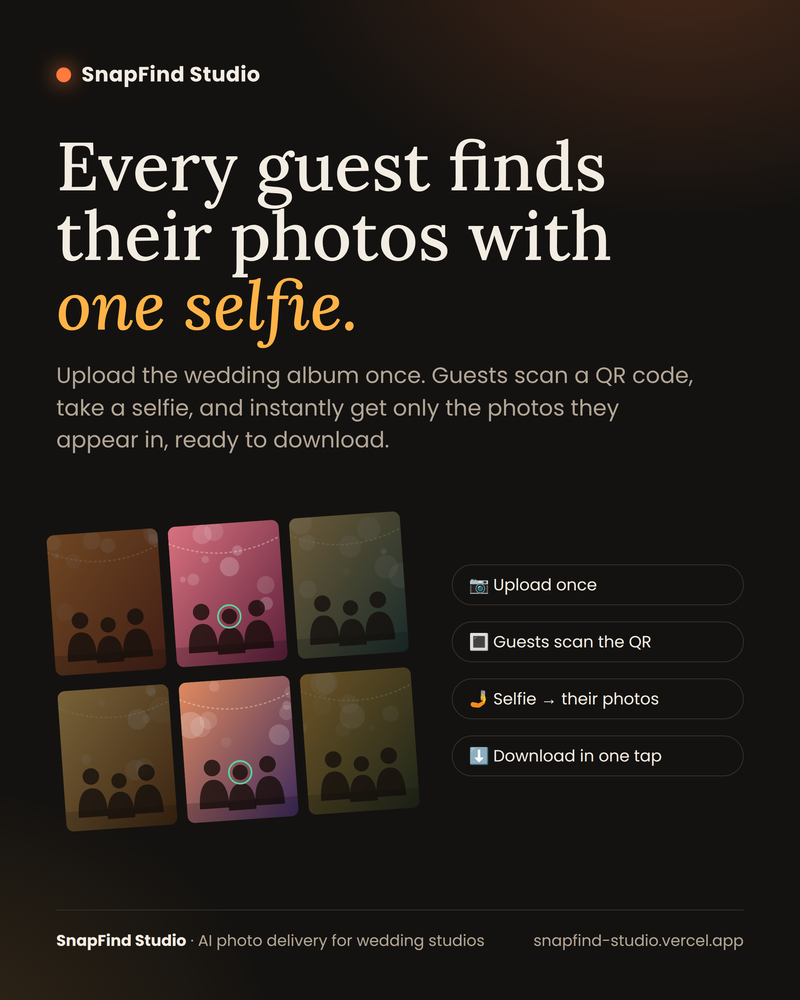
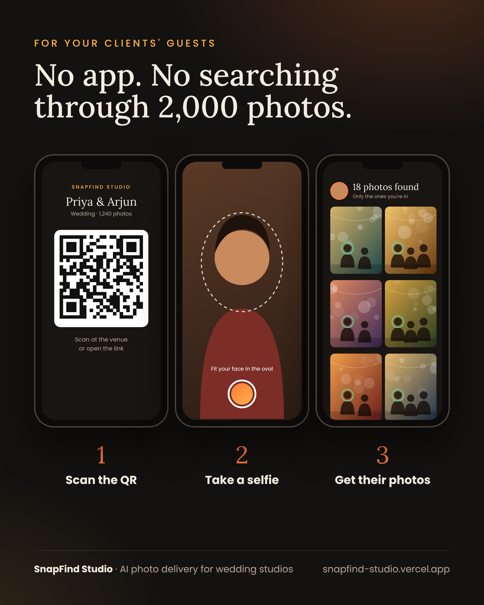

# SnapFind Studio: photo delivery by face

Created by **Perarasu Boopathirajan** · © 2026 · All rights reserved



| For guests | For the studio |
|---|---|
|  |  |


The studio uploads event photos. Guests scan a QR code, take a selfie with the front camera, and see and download only the photos they appear in.

## Pages

| Who | URL | What it does |
|---|---|---|
| Guest | `/` | Landing page with an "enter event code" box |
| Guest | `/e/<event-code>` | Front camera or selfie upload, matched photos, single download, ZIP download |
| Admin | `/admin/login` | Studio login |
| Admin | `/admin` | Dashboard with stats and event creation |
| Admin | `/admin/events/<id>` | Bulk photo upload (drag & drop), QR code, printable poster, ZIP of all photos, delete |

## How matching works

* **Upload:** every face in every photo is detected (OpenCV **YuNet**) and turned into a 128-number "face fingerprint" (OpenCV **SFace**). The fingerprint is stored in SQLite.
* **Selfie:** the guest's face is fingerprinted the same way and compared against every face in that event (cosine similarity). Photos scoring ≥ `MATCH_THRESHOLD` are returned, best match first.
* It's free and runs on CPU, with no paid API. The selfie is never saved.

## Security

* **No default password.** If `ADMIN_PASSWORD` isn't set, a random one is generated on every start and printed in the server log. Always set your own.
* **CSRF protection** on every admin action (create/delete event, upload/delete photo, log out).
* **Login throttling:** 10 failed attempts from one IP locks that IP out for 15 minutes.
* Guests get no cookies. Photo links use unguessable 128-bit IDs.
* Heavy face processing runs in worker threads, and ZIP downloads are built on disk instead of in memory, so one big upload or download can't freeze or crash the server.

## Deploy to Hugging Face Spaces

1. Go to https://huggingface.co/new-space. Pick a name, set **SDK = Docker** and **template = Blank**, and choose the free **CPU basic** hardware.
2. Upload every file in this folder (`Dockerfile`, `README.md`, `requirements.txt`, `app/…`) with **Files → Add file → Upload files**, or push them with git.
3. Open **Settings → Variables and secrets** and add these **secrets**:
   * `ADMIN_PASSWORD`: your admin password (**required**; without it a temporary one is printed in the Logs tab on every restart)
   * `SECRET_KEY`: any long random text (keeps admins logged in across restarts)
   * Optional **variables**: `ADMIN_USER` (default `admin`) and `STUDIO_NAME` (shown on every page)
4. Wait for the build (about 3–5 minutes), then open the app at `https://<your-user>-<space-name>.hf.space/admin`.
   Use this direct `.hf.space` link rather than the huggingface.co page, so the camera and login work properly.

### ⚠️ Storage
Free Spaces **lose all files when they restart** (after about 48 hours of inactivity, or on any rebuild). For real events:
* turn on **Settings → Persistent storage** (paid, from about $5/month for 20 GB). The app detects `/data` automatically and saves photos and the DB there, **or**
* move to a VPS later. Nothing in the code changes; just set `DATA_DIR`.

## Settings (environment variables)

| Name | Default | Meaning |
|---|---|---|
| `ADMIN_USER` / `ADMIN_PASSWORD` | `admin` / *random, printed in log* | Admin login |
| `SECRET_KEY` | random per boot | Signs the admin session cookie |
| `STUDIO_NAME` | `SnapFind Studio` | Brand name on every page |
| `MATCH_THRESHOLD` | `0.40` | Higher means stricter matching (fewer wrong photos). Lower means more photos found. Range 0.36–0.50 |
| `PUBLIC_URL` | auto | Base URL put in the QR code (auto-detected on HF) |
| `DATA_DIR` | `/data/snapfind` if available, else `./data` | Where photos and the DB live |
| `MAX_UPLOAD_MB` | `40` | Maximum size per uploaded photo |

## Run on your own computer

```bash
pip install -r requirements.txt
uvicorn app.main:app --port 7860
# set a password first (PowerShell: $env:ADMIN_PASSWORD="your-password"; macOS/Linux: export ADMIN_PASSWORD=your-password)
# open http://localhost:7860/admin  (login: admin / your password)
```
Face models download automatically on first start (about 39 MB).
Browsers only allow the camera on **https** or `localhost`. On a phone over plain http, use the "Upload a selfie instead" button.

## Tips for best results
* Upload the normal JPEG exports. Huge RAW files aren't needed, and anything over 1920 px is scaled down for face detection only. Guests still download the full-resolution original.
* Very small faces in large group photos (under about 28 px) are skipped. Lower `MIN_FACE_PX` to catch them.
* A free CPU Space indexes roughly 2–5 photos per second.

## Author

**Perarasu Boopathirajan** — design, development and architecture.

## License

Copyright © 2026 Perarasu Boopathirajan. All rights reserved. See [LICENSE](LICENSE).
